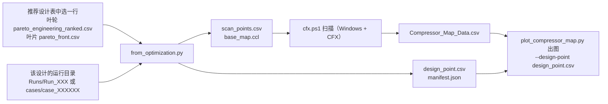

# 优化结果 → 特性图

优化仓库给出的是一张"推荐设计表"。本文说明怎样从中选出一个设计，自动生成一次转速扫描所需要的全部输入，
最后画出标有该设计位置的特性图。这一步由 `from_optimization.py` 完成。
它只做文件转换，**不运行 CFD**，只用到 Python 标准库。



做的事情可以概括为：

1. 在推荐设计表里选中一行；
2. 找到这个设计当初在 CFD 里的运行目录，核对设计参数确实对得上；
3. 以这个设计的转速为中心，生成一组转速线（默认设计转速的 ±20%，每 5% 一档）；
4. 写出扫描点、基础 CCL、设计点，以及一份记录来源的说明文件 `manifest.json`，里面附有后续扫描和出图的完整命令。

## 先在本机试一遍（不需要 CFX）

```sh
python -m pip install -r requirements.txt
python examples/from_optimization/run_example.py
```

一条命令完成叶轮和叶片两条链路，输出在 `example-output/from_optimization/`
（必须是新目录或空目录，可用 `--output-dir` 指定）。所用的数据、运行目录和特性图全部是合成的，
详见 [演示示例说明](../examples/from_optimization/README.md)。

## 怎么用

```sh
# 叶轮优化的结果
python from_optimization.py --source impeller \
  --results <工作区>/pareto_engineering_ranked.csv --select engineering_rank=1 \
  --runs-root <工作区>/Runs --runs-root <工作区>/ActiveLearning_Runs \
  --audit-csv <工作区>/failure_records.csv --source-repo <叶轮仓库 checkout> \
  --data-source cfd --def-ccl def.ccl --output-dir <新目录>

# 叶片优化的结果
python from_optimization.py --source blade \
  --results <输出目录>/pareto_front.csv --select run_id=case_000123 \
  --source-repo <叶片仓库 checkout> --data-source cfd --def-ccl def.ccl --output-dir <新目录>
```

### 参数说明

| 参数 | 说明 |
|---|---|
| `--source` | 来源：`impeller`（叶轮）或 `blade`（叶片） |
| `--results` | 推荐设计表。叶轮可用 `pareto_engineering_ranked.csv`、`pareto_front_points.csv` 或训练数据表；叶片可用 `pareto_front.csv` 或 `training_data.csv`。模型预测出来的设计表（`nsga2_surrogate_pareto.csv`）没有对应的 CFD 运行目录，会被拒绝 |
| `--select 列名=值` / `--row N` | 选中其中一行，必须恰好选中一行；表里只有一行时可省略 |
| `--run-dir` | 直接指定运行目录（仍会核对设计参数） |
| `--runs-root` | 在哪里找运行目录，可重复给出。叶轮：在其子目录里按设计参数搜索；叶片：在 `<root>/<run_id>` 和 `<root>/cases/<run_id>` 里找 |
| `--audit-csv` | 叶轮的 `failure_records.csv`，当某个主动学习目录没有 `input_parameters.json` 时，从这里读设计参数 |
| `--design-variables` | 自定义变量表；默认使用两个仓库内置的变量表 |
| `--design-rpm` | 设计转速，默认 10000 rpm |
| `--design-p-out-pa` | 设计背压；默认取表内的 `P_out`（叶轮）或 `cfx_state.json` 里的 `p_out_pa`（叶片） |
| `--passage-count` | `MassFlow` 代表几个流道；默认取叶轮的 `nBl` 或叶片的 `n_blades` |
| `--speed-span` / `--speed-step` | 转速线范围与步长，默认 ±20%、每 5% 一档，即 8000 到 12000 rpm 共 9 条 |
| `--speeds-rpm` | 直接给出转速列表，优先于上面两项 |
| `--initial-pressure-pa` | 每条转速线的起始背压，默认 5 Pa，不得达到扫描脚本的安全上限 16 Pa |
| `--pr-type` | 出图命令使用的压比，默认 `static`；`total` 对应优化目标的口径 |
| `--plot-style` | 出图样式，默认 `paper`（论文风格）；`map` 为按效率着色的特性图 |
| `--mass-flow-unit` | 传给扫描脚本的 CFD-Post 流量单位，默认 `g/s`（两个优化仓库用的单位） |
| `--def-ccl` | 求解输入导出的 CCL 文本，用来核对转速表达式 `MySpeed` 和背压表达式 `MyBackPressure` 是否真的被模板用上 |
| `--bind-speed-domain` | 在 `base_map.ccl` 里为指定的旋转域写入"转速 = `MySpeed`" |
| `--source-repo` / `--source-commit` | 优化仓库的本地 checkout 路径（自动读取版本）或网址加版本号，写入 manifest 以便追溯 |
| `--data-source` | 数据性质，例如 `cfd`；以 `synthetic` 开头时，图上会标注 SYNTHETIC（合成数据） |

## 怎么找到设计对应的运行目录

- **叶轮**：推荐设计表里没有运行编号。程序逐个读取运行目录里的 `input_parameters.json`
  （主动学习的目录若缺失，就查 `--audit-csv`），把设计参数逐项比对，容许 1e-6 量级的相对误差；
  叶片数按求解时实际使用的四舍五入后的整数比较。同一设计算过多次时，取有 `CFX_Results.txt` 的那个。
  最终必须**恰好匹配一个**目录，零个或多个都会报错并列出候选。
- **叶片**：依次尝试表里的 `case_dir`、`--runs-root` 下的 `<run_id>` 或 `cases/<run_id>`、
  推荐设计表同级的 `cases/<run_id>`。`case_dir` 是优化那台机器上的绝对路径，换机器后会自动回退到后面几项。
  找到后用 `candidate.json` 核对设计参数。
- **用哪个结果文件**：叶片按 `cfx_state.json` 里记录的、已经完成（或人工审核通过）的求解的 `result_file` 取 `.res`，
  不会被后来出现的其他 `.res` 顶替；若记录显示求解没完成（失败、运行中、需要重启等），直接报错，不回退到目录里别的文件。
  叶轮取最新的 `.out` 对应的 `.res`。
- **叶轮运行目录里通常没有 `.def`**：叶轮的运行程序在后处理成功后会把求解输入和网格清理掉，只留下 `.res`。
  这时转换器把 `.res` 同时当作求解输入和初始流场，并写进 manifest。需要按下文的验证步骤，在 Windows 上做一次单点验证。
- **性能核对**：如果有 `CFX_Results.txt`（单流道流量和功率），按流道数换算后与推荐设计表对比，容许 1e-5 的相对误差。
  不一致只会记录在 manifest 中，设计点仍使用推荐设计表里的优化记录。叶轮的推荐设计表不含静压比，
  转换器会从 `CFX_Results.txt` 补上；两处都没有时，设计点只能以总压比出图（`--pr-type total`）。

## 输出了什么

输出目录必须是新目录或空目录，避免覆盖已有的说明文件。

| 文件 | 内容 |
|---|---|
| `scan_points.csv` | 要扫描的转速和起始背压，格式见 [数据格式说明](data_format.md) |
| `base_map.ccl` | 设计转速和设计背压对应的两个表达式 `MySpeed`、`MyBackPressure`；扫描脚本会逐点改写这两行。加 `--bind-speed-domain` 时还附带旋转域转速的设置 |
| `design_point.csv` | 设计点的转速、背压、流量、总压比、静压比、效率，以及它对应的 `.res` 文件名 |
| `manifest.json` | 来源与核对结果的完整记录（见下） |

`manifest.json` 里主要有：

| 部分 | 内容 |
|---|---|
| 生成者 | 本仓库的版本，以及是否有未提交的改动 |
| 来源 | 优化器、数据性质、仓库与版本、推荐设计表的路径和指纹（SHA-256）、选择条件、行号、编号 |
| 设计参数 | 完整的设计变量 |
| 记录的性能 | 效率、总压比、静压比（及其来源）、全叶轮流量、功率，以及各自的口径 |
| 工况 | 设计转速、背压、流道数，以及各自的来源 |
| 运行 | 运行目录、定位方式、所用的求解输入和初始流场文件的路径、大小与修改时间 |
| 核对结果 | 设计参数、性能、表达式绑定三项核对各自是 `match`、`mismatch`、`unavailable`、`bound` 还是 `unchecked` |
| 扫描设置 | 转速线、起始背压、安全上限、流量单位、压比口径 |
| 命令 | 后续扫描和出图的完整命令 |
| 提示 | 所有警告，同时输出到终端 |

## 出图

manifest 里的出图命令默认用 `plot_compressor_map.py --style paper`，按论文习惯画双栏宽（7.0 英寸）的两张子图：

- (a) 压比—质量流量：每条转速线一种空心标记，颜色按转速顺序取 viridis 色带（黑白打印也能分辨先后），
  虚线是喘振线，只连接各转速线的喘振点；
- (b) 等熵效率—质量流量：标记和颜色与 (a) 一致；
- 两张图都用黑色星号标出设计点，图下注释写明优化记录的流量、压比、效率和工况，以及 `--design-label` 给出的来源；
- 衬线字体（优先 Times New Roman，缺失时依次用 STIX、DejaVu Serif），刻度朝内并画在四边，图例放在两张子图上方；
- 输出格式由扩展名决定：`.png` 为 600 dpi，`.pdf`、`.svg` 为矢量图（PDF 内嵌 TrueType 字体，可在排版软件中编辑）。

`--plot-style map` 仍可输出原来按效率着色的特性图。图形界面里的手动和自动绘图不受影响，继续使用特性图样式。

## 几个口径要对齐

- **压比**：两个优化仓库 CSV 里的 `totalpressureratio` 与本仓库的 `Total_PR` 是同一个定义（静止系质量流量平均总压的出口/进口之比）；
  `PressureRatio` 与 `Static_PR` 都是静压比。出图命令默认画静压比，要与优化目标对照就改用 `--pr-type total`。
- **流量**：优化表里的 `MassFlow` 是全叶轮流量，单位相当于 g/s。设计点写为 `Mass_Flow_kg_s = MassFlow / 1000`，
  流道数写进 `Blade_Count`；出图时用 `--blade-count <流道数>`，这样星号横坐标就等于 `MassFlow`。
  扫描脚本使用同样的叶片数，扫描结果与设计点按同一口径换算。
- **背压**：`MyBackPressure` 与优化仓库的运行程序写出的是同一个表达式，数值约定相同（相对模板自己的参考压力）。

## 在 Windows + CFX 上真实运行

### 先确认两件事

转换器在离线状态下无法确认下面两点，它们来自前期的技术基线调查（POLA-7）：

- 两个优化仓库的运行程序都只写 `MyBackPressure`，叶片界面的说明也写明模板的出口引用它；
  但**两个仓库里都没有出现 `MySpeed`**，模板里的转速可能是写死的。下面的第 2、3 步会核对这一点。
- `P_out = 12 [Pa]` 相对于哪个参考压力还有待确认。扫描背压与它约定相同；如果参考压力不同，
  需要相应调整 `--initial-pressure-pa` 和扫描脚本里 16 Pa 的安全上限。

### 步骤

1. **准备环境。** 在工程机上准备本仓库、Python 3（带 numpy、matplotlib）、PowerShell 7，并确认
   `cfx5solve`、`cfx5post`、`cfx5cmds` 可用。下文的 `python` 可换成 `py -3`。
2. **导出模板的 CCL 文本。** `cfx5cmds -read -def <运行目录>\Impeller.def -text def.ccl`。
   叶轮运行目录里没有 `.def` 时，对 `.res` 执行同样的命令。
3. **运行转换器。** 按上文"怎么用"运行，并加 `--def-ccl def.ccl`。
   - 若报错 `rotor speed ignores MySpeed`，说明模板的转速是写死的。按报错里的旋转域名称加 `--bind-speed-domain <域名>`（通常是 `R1`）重新运行。
   - 若报错 `no OUTLET/OPENING boundary uses MyBackPressure`，说明出口边界没有引用这个表达式（报错会列出实际引用它的位置），需要先修改模板。
4. **单点验证（必做）。**
   - 把 `scan_points.csv` 改成只有设计转速一行，起始背压等于设计背压，运行 manifest 里 `commands.cfx_sweep` 的命令。
   - 新增的一行中，`Total_PR`、`Isentropic_Efficiency` 和 `Mass_Flow_kg_s × 1000` 应与 manifest 里"记录的性能"在收敛误差内一致。
     流量相差 1000 倍，说明 `--mass-flow-unit` 选错了。
   - 再取一个非设计转速（例如 9000 rpm）单点计算，在 CFD-Post 中确认转速确实变了，这证明 `MySpeed` 生效。
   - 如果求解输入是 `.res` 而 `cfx5solve` 不接受它作为 `-def`，在 CFX-Pre 里打开这个 `.res` 另存为 `.def`，
     再把命令里的 `-DefFile` 换成新文件。
5. **完整扫描。** 恢复 `scan_points.csv`（或重新运行转换器，输出到新目录），运行 `commands.cfx_sweep`。
   已经算过的工况会被扫描脚本直接复用。
6. **出图。** 运行 `commands.plot`，得到论文风格的 (a) 静压比—流量、(b) 效率—流量图。
   星号应落在设计转速线上、设计背压附近；明显偏离时先回头排查第 4 步。投稿要矢量图时，把 `--output` 的扩展名改成 `.pdf` 或 `.svg`。
7. **归档。** 保存 `manifest.json`、`Compressor_Map_Data.csv` 和特性图。manifest 记录了推荐设计表的指纹和优化仓库的版本，
   日后可以对应回优化时的状态。

真实扫描的结果不属于本仓库离线测试的验收条件。
