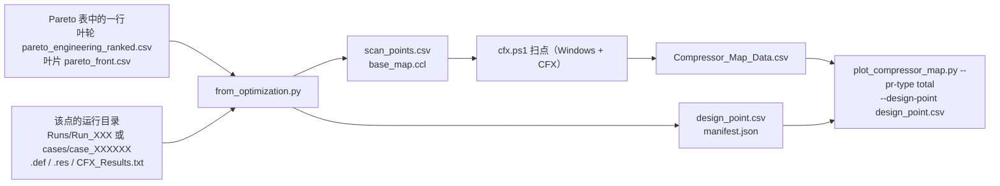

# 优化结果 → 特性图

`from_optimization.py` 把叶轮或叶片优化 Pareto 表中选定的一行，转换成 `cfx.ps1` 扫点和 `plot_compressor_map.py` 出图所需的输入，并写一份可追溯来源的 manifest。转换本身不运行 CFD，只依赖 Python 标准库。



## 离线示例

```bash
python -m pip install -r requirements.txt
python examples/from_optimization/run_example.py
```

一条命令完成叶轮和叶片两条链路，输出在 `example-output/from_optimization/`（必须是新目录或空目录，可用 `--output-dir` 指定）。所用数据、替身运行目录和特性图全部是**合成数据**，说明见 [examples/from_optimization/README.md](../examples/from_optimization/README.md)。测试：`python -m unittest discover -s tests -v`。

## 用法

```bash
python from_optimization.py --source impeller \
  --results <工作区>/pareto_engineering_ranked.csv --select engineering_rank=1 \
  --runs-root <工作区>/Runs --runs-root <工作区>/ActiveLearning_Runs \
  --audit-csv <工作区>/failure_records.csv --source-repo <叶轮仓库 checkout> \
  --data-source cfd --def-ccl def.ccl --output-dir <新目录>

python from_optimization.py --source blade \
  --results <输出目录>/pareto_front.csv --select run_id=case_000123 \
  --source-repo <叶片仓库 checkout> --data-source cfd --def-ccl def.ccl --output-dir <新目录>
```

| 参数 | 说明 |
| --- | --- |
| `--source` | `impeller` 或 `blade` |
| `--results` | 叶轮：`pareto_engineering_ranked.csv`、`pareto_front_points.csv` 或训练 CSV；叶片：`pareto_front.csv` 或 `training_data.csv`。代理预测表 `nsga2_surrogate_pareto.csv` 没有对应的 CFD 运行目录，会被拒绝 |
| `--select COLUMN=VALUE` / `--row N` | 必须恰好选中一行；表只有一行时可省略 |
| `--run-dir` | 直接指定运行目录，仍会核对设计向量 |
| `--runs-root` | 叶轮：在其子目录中按设计向量搜索；叶片：在 `<root>/<run_id>` 和 `<root>/cases/<run_id>` 中查找。可重复 |
| `--audit-csv` | 叶轮 `failure_records.csv`，为缺少 `input_parameters.json` 的主动学习目录提供设计向量 |
| `--design-variables` | 自定义变量表（`{"variables": [{"name": ...}]}`，即叶轮 `design_variables.json` 或叶片配置）；默认使用两个仓库的内置变量表 |
| `--design-rpm` | 设计转速，默认 10000 rpm |
| `--design-p-out-pa` | 设计背压；默认取行内 `P_out`（叶轮）或 `cfx_state.json` 的 `p_out_pa`（叶片） |
| `--passage-count` | `MassFlow` 代表的流道数；默认取叶轮的 `nBl` 或叶片 `cfx_state.json` 的 `n_blades` |
| `--speed-span` / `--speed-step` | 转速线为设计转速 × (1 ± k·step)，默认 ±20%、步长 5%，即 8000–12000 rpm 共 9 条 |
| `--speeds-rpm` | 显式转速列表，覆盖 span/step |
| `--initial-pressure-pa` | 每条转速线的起始背压，默认 5 Pa；不得达到 `cfx.ps1` 的安全上限 16 Pa |
| `--pr-type` | 出图命令使用的压比，默认 `total`（优化目标） |
| `--mass-flow-unit` | 传给 `cfx.ps1` 的 CFD-Post 流量单位，默认 `g/s`（两个优化仓库的 CFX 单位制） |
| `--def-ccl` | 求解输入的 CCL 文本，用于核对 `MySpeed` / `MyBackPressure` 是否真的驱动转速和出口边界 |
| `--bind-speed-domain` | 在 `base_map.ccl` 中为该旋转域写入 `Angular Velocity = MySpeed` |
| `--source-repo` / `--source-commit` | 优化仓库的 checkout 路径（自动读取 commit）或 URL 加 commit |
| `--data-source` | 数据性质，例如 `cfd`；以 `synthetic` 开头时图中标注 SYNTHETIC |

## 定位运行目录

- **叶轮**：结果表的行没有 run ID。转换器读取每个运行目录的 `input_parameters.json`（主动学习目录缺失时改查 `--audit-csv`），按设计变量逐项比对，容差为 `1e-6 + 1e-6·|值|`；`nBl` 按求解时实际执行的 `round(nBl)` 比较。同一设计重算过时，只取有 `CFX_Results.txt` 的那个目录；`input_parameters.json` 读不出的目录会跳过并记入 notes。最终必须恰好匹配一个目录，零个或多个都会报错并列出候选。
- **叶片**：依次尝试行内 `case_dir`、`--runs-root` 下的 `<run_id>` / `cases/<run_id>`、结果表同级的 `cases/<run_id>`。`case_dir` 是优化机器上的绝对路径，换机器后会自动回退到后面几项。随后用 `candidate.json` 核对设计向量。
- **求解文件**：叶片按 `cfx_state.json` 中已完成求解记录的 `result_file` 取 `.res`，不会被后来出现的其他 `.res` 替换；叶轮取最新 `.out` 对应的 `.res`。
- **叶轮 runner 在后处理成功后会删除 `Impeller.def` 和网格**（`cfx_runner.py` 的清理步骤），运行目录里通常只剩 `.res`。这时转换器把 `.res` 作为 `-DefFile` 和 `-InitialResFile`，并在 manifest 中写明，需按下文第 4 步在 Windows 上单点验证。
- **性能核对**：如有 `CFX_Results.txt`（单流道流量和功率），按流道数换算后与结果表比对，相对容差 1e-5。不一致只记录在 manifest 中，设计点仍使用结果表中的优化记录。叶轮 Pareto 表不含静压比，转换器从 `CFX_Results.txt` 补齐；两处都没有时，设计点只能以总压比出图。

## 输出

| 文件 | 内容 |
| --- | --- |
| `scan_points.csv` | `SpeedRPM,InitialPressurePa`，格式见 [数据格式](data_format.md) |
| `base_map.ccl` | `MyBackPressure` 和 `MySpeed` 表达式，取设计值；`cfx.ps1` 逐点改写这两行。加 `--bind-speed-domain` 时附带旋转域转速覆盖 |
| `design_point.csv` | schema v1 单行：设计转速和背压、`Mass_Flow_kg_s = MassFlow/1000`、`Blade_Count = 流道数`、`Total_PR`、`Static_PR`、`Isentropic_Efficiency`；`Result_File` 为该点的 `.res` 名 |
| `manifest.json` | 见下表 |

manifest（`manifest_version = 1`）主要字段：

| 字段 | 内容 |
| --- | --- |
| `generator` | 本仓库 commit 和是否有未提交改动 |
| `source` | 优化器、`data_source`、仓库、commit、结果表路径和 SHA-256、选择条件、数据行号与文件行号、`engineering_rank` / `front_index` / `run_id` |
| `design_vector` | 完整设计变量 |
| `recorded_performance` | 效率、总压比、静压比（及来源）、全叶轮流量 g/s、功率，以及各量口径 |
| `operating_point` | 设计转速、背压、流道数，以及各自来源 |
| `run` | 运行目录、定位方式、求解输入（`def` 或 `res`）和初场文件的路径、大小、修改时间 |
| `checks` | 设计向量、性能、表达式绑定三项核对的结果（`match` / `mismatch` / `unavailable` / `bound` / `unchecked`） |
| `sweep` | 转速线、起始背压、安全上限、流量单位、压比口径 |
| `commands` | 后续 `cfx.ps1` 扫点和出图的完整命令（`argv` 列表和可显示字符串） |
| `notes` | 所有警告，同时输出到 stderr |

输出目录必须是新目录或空目录，避免覆盖描述已有扫点的 manifest。

## 口径

- **压比**：两个优化仓库 CSV 中的 `totalpressureratio` 与本仓库 `Total_PR` 定义一致，都是静止系质量流量平均总压的出口/进口比值；`PressureRatio` 与 `Static_PR` 都是静压比。出图命令默认 `--pr-type total`，与优化目标一致。
- **流量**：优化 CSV 的 `MassFlow` 是全叶轮流量，单位相当于 g/s。设计点写为 `Mass_Flow_kg_s = MassFlow/1000`、`Blade_Count = 流道数`；出图命令使用 `--blade-count <流道数>`，星号横坐标即为 `MassFlow`。`cfx.ps1` 使用相同的 `-BladeCount`，扫点结果与设计点按同一口径换算。
- **背压**：`MyBackPressure` 与优化 runner 写入 `update_bc.ccl` 的是同一个表达式，数值约定相同（相对模板参考压力）。

## Windows + CFX 真实运行步骤

**前提**（来自 POLA-7 待确认事项，转换器无法离线确认）：

- 两个优化仓库的 runner 都只写 `MyBackPressure`，叶片 GUI 的说明也写明模板出口引用它；**两个仓库都没有出现 `MySpeed`**，模板里的转速可能是写死的。第 2–3 步会核对这一点。
- `P_out = 12 [Pa]` 相对于哪个参考压力仍待确认。扫点背压与之约定相同；如参考压力不同，需相应调整 `--initial-pressure-pa` 和 `cfx.ps1` 的安全上限 16 Pa。

**步骤**：

1. 在工程机上准备本仓库、Python 3（numpy、matplotlib）、PowerShell 7，并确认 `cfx5solve`、`cfx5post`、`cfx5cmds` 可用。下文命令中的 `python` 可换成 `py -3`。
2. 导出求解输入的 CCL：`cfx5cmds -read -def <运行目录>\Impeller.def -text def.ccl`。叶轮运行目录中没有 `.def` 时，对 `.res` 执行同一命令。
3. 按“用法”运行转换器，并加 `--def-ccl def.ccl`。如果报错 `rotor speed ignores MySpeed`，按错误信息中的旋转域名称加 `--bind-speed-domain <域名>`（通常为 `R1`）重新运行；如果报错 `no boundary uses MyBackPressure`，说明模板出口不引用该表达式，需要先修改模板。
4. **单点验证**（必做）：
   - 把 `scan_points.csv` 改为只有设计转速一行、起始背压等于设计背压，运行 manifest 中 `commands.cfx_sweep` 的命令。
   - 新增的 `Compressor_Map_Data.csv` 行中，`Total_PR`、`Isentropic_Efficiency` 和 `Mass_Flow_kg_s × 1000` 应与 `recorded_performance` 在收敛容差内一致。流量相差 1000 倍说明 `--mass-flow-unit` 选错了。
   - 再取一个非设计转速（例如 9000 rpm）单点计算，在 CFD-Post 中确认转速确实改变，证明 `MySpeed` 生效。
   - 如果求解输入是 `.res`，而 `cfx5solve` 不接受它作为 `-def`，可在 CFX-Pre 中打开该 `.res` 另存为 `.def`，再把命令中的 `-DefFile` 换成新文件。
5. 完整扫描：恢复 `scan_points.csv`（或重新运行转换器输出到新目录），运行 `commands.cfx_sweep`。已算过的工况会被 `cfx.ps1` 复用。
6. 出图：运行 `commands.plot`。星号应落在设计转速线上设计背压附近；明显偏离时，先排查第 4 步的各项。
7. 归档 `manifest.json`、`Compressor_Map_Data.csv` 和特性图。manifest 记录了结果表的 SHA-256 和优化仓库 commit，可以对应回优化时的状态。

真实扫点结果不是本仓库离线测试的验收条件。
